# **Claude Desktop** on **LLM-Kita**, no stress

### A hands-on 3P setup guide

Author: **LLM-Kita** Team

You want **Claude Desktop** but the official sub hits different (read: expensive). **LLM-Kita** is a third-party gateway that runs the similar **Anthropic Claude**-compatible models for less, and this guide walks you through flipping **Claude Desktop** into 3P mode in about ten minutes. We got you.

No CLI wizardry required. One script does the heavy lifting. You bring the key, the script handles the rest, and by the end **Claude Desktop** is chatting through **LLM-Kita** instead of draining your wallet.

> Heads up: the script file is `Enable-Claude3P.ps1`. Older downloads may name it `Enable-Claude3pGateway.ps1`. Same file, older label. Use whatever name you saved.

---

## Map

This is a Map of Content. Jump wherever you need, but first-timers should go top to bottom.

| Step | What you do there |
|---|---|
| [Step-1](#step-1-sign-up-and-grab-your-api-key) | Create your **LLM-Kita** account and API key |
| [Step-2](#step-2-stash-your-key-somewhere-safe) | Copy the key into a safe spot |
| [Step-3](#step-3-check-your-prerequisites) | Confirm PowerShell, **Claude Desktop**, and Git are ready |
| [Step-4](#step-4-quit-claude-desktop-fully) | Close Claude so the script can write safely |
| [Step-5](#step-5-get-the-script-on-your-machine) | Download `Enable-Claude3P.ps1` |
| [Step-6](#step-6-open-windows-terminal) | Open a terminal to run the script |
| [Step-7](#step-7-run-a-dry-run-audit-optional-but-smart) | Preview what would change, no writes |
| [Step-8](#step-8-run-the-setup-command) | Fire the real setup command |
| [Step-9](#step-9-paste-your-key-at-the-prompt) | Feed the key in if you skipped -NewKey |
| [Step-10](#step-10-confirm-the-apply) | Say yes to the safety prompt |
| [Step-11](#step-11-let-the-script-cook) | Watch it write and verify |
| [Step-12](#step-12-run-the-verification-command) | Confirm the log is clean |
| [Step-13](#step-13-relaunch-claude-desktop) | Open Claude from the Start menu |
| [Step-14](#step-14-continue-at-the-3p-sign-in) | Pass the 3P sign-in screen |
| [Step-15](#step-15-open-inference-configuration) | Find the connection settings |
| [Step-16](#step-16-test-the-connection) | Click Test and watch it go green |
| [Step-17](#step-17-verify-model-discovery) | Confirm the models show up |
| [Step-18](#step-18-start-chatting-or-coding) | You are in. Go build something |
| [Step-19](#step-19-troubleshooting) | Fix it when something breaks |
| [Step-20](#step-20-undo-everything-with-restore) | Revert to stock Anthropic mode |

---

## Step-1: Sign up and grab your API key

First, you need an **LLM-Kita** account and a funded balance. Sign up at **LLM-Kita**, then recharge your saldo for Pay-As-You-Go or buy an LLM Package. Once funded, open the Developer menu inside your management dashboard and create an API key.

This is the one credential the whole setup revolves around, so take a second to do it right.

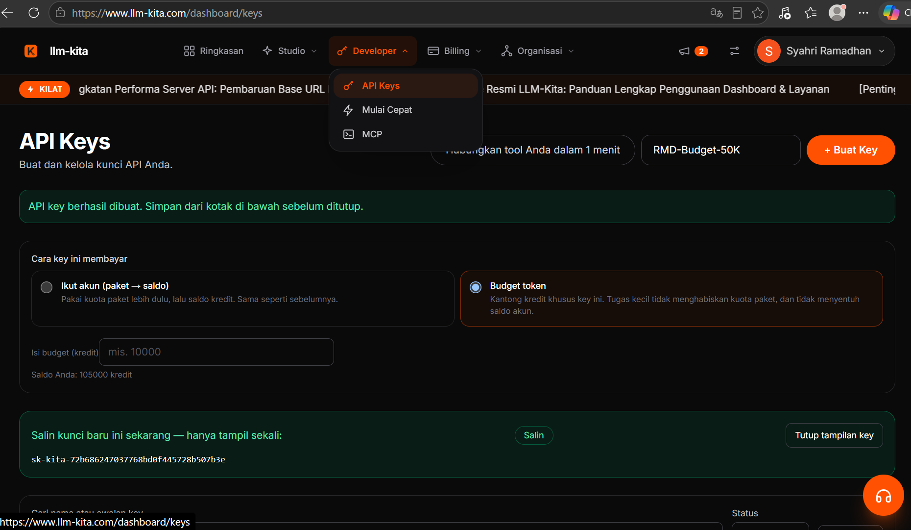

---

## Step-2: Stash your key somewhere safe

Copy the generated key and save it somewhere secure. A password manager is ideal. If you do not have one, open `notepad.exe`, paste the key in, and keep that window open. You will need to paste the key again in a later step, so do not close it yet.

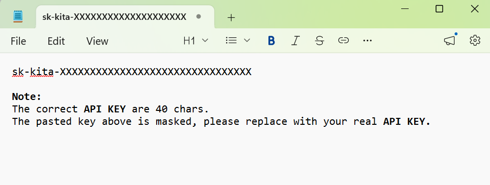

---

## Step-3: Check your prerequisites

Before you run anything, make sure your machine is ready. You need three things, and Git is recommended but not strictly required.

| Need | Why | How to check |
|---|---|---|
| PowerShell 5.1 or newer | Runs the script | `$PSVersionTable.PSVersion` |
| **Claude Desktop** installed | The app we are flipping to 3P | winget or Microsoft Store |
| Git for Windows | Recommended for the CLI tool tab | `git --version` |
| Your **LLM-Kita** API key | The gateway credential | From Step-1 |

If PowerShell is older than 5.1, update Windows first. If Git is missing, install it with `winget install Git.Git`. The script works without Git, but the Code tab's Bash git shortcuts will not function until Git is on the machine.


---

## Step-4: Quit **Claude Desktop** fully

Claude reads its config at launch, not on the fly, so you must close it before the script writes. Right-click the Claude system-tray icon and select Exit. Then check Task Manager to confirm no `Claude.exe` process is still hanging around.

If you skip this and Claude is still running, the script will warn you and ask if you want to proceed. Easier to just close it now.

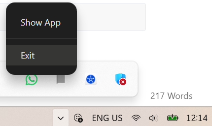

---

## Step-5: Get the script on your machine

Download `Enable-Claude3P.ps1` from the **LLM-Kita** GitHub repository. Save it somewhere easy to reach, like your Desktop or a scripts folder.

```powershell
# Download from the **LLM-Kita** GitHub repo (replace with the real raw URL)
Invoke-WebRequest -Uri "<**LLM-Kita**-GITHUB-RAW-URL>/Enable-Claude3P.ps1" -OutFile "$HOME\Desktop\Enable-Claude3P.ps1"
```

If you already have the script file, just note where it lives. You will point the terminal at it in the next step.


---

## Step-6: Open Windows Terminal

Open Windows Terminal. Right-click the Windows Start logo and pick Terminal. A regular non-admin terminal is fine for the default flow. You only need admin if you plan to use the optional `-MachineEnv` flag later, which writes a machine-wide env var.

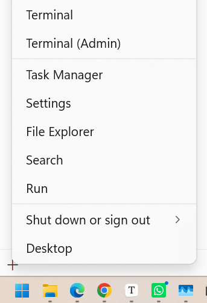

The terminal opens and you are ready to navigate to the script.

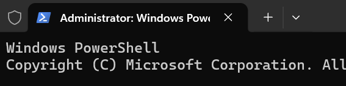

---

## Step-7: Run a dry-run audit (optional but smart)

Not sure what state your machine is in? Run the script with no flags first. It will report your current 3P state, probe both **LLM-Kita** endpoints, list every credential location, and print stale keys on disk. Nothing gets written. This is the safe preview.

Change into the folder where you saved the script, then run it bare:

```powershell
cd $HOME\Desktop
.\Enable-Claude3P.ps1
```

You will see a `Mode: DRY RUN` banner and a full report. Read it, then move on to the real apply.


---

## Step-8: Run the setup command

Now the real deal. This is the recommended first-time command for non-experts. It probes the gateway, shows you a summary, and asks for confirmation before writing anything.

```powershell
.\Enable-Claude3P.ps1 -Interactive -NewKey "YOUR-**LLM-Kita**-KEY"
```

Replace `YOUR-**LLM-Kita**-KEY` with the key from Step-1. If you are running PowerShell from the script's own folder and get an execution-policy error, prefix with a bypass:

```powershell
powershell -ExecutionPolicy Bypass -File .\Enable-Claude3P.ps1 -Interactive -NewKey "YOUR-**LLM-Kita**-KEY"
```

The script prints its banner, resolves your Claude install directories, and starts the key sourcing.

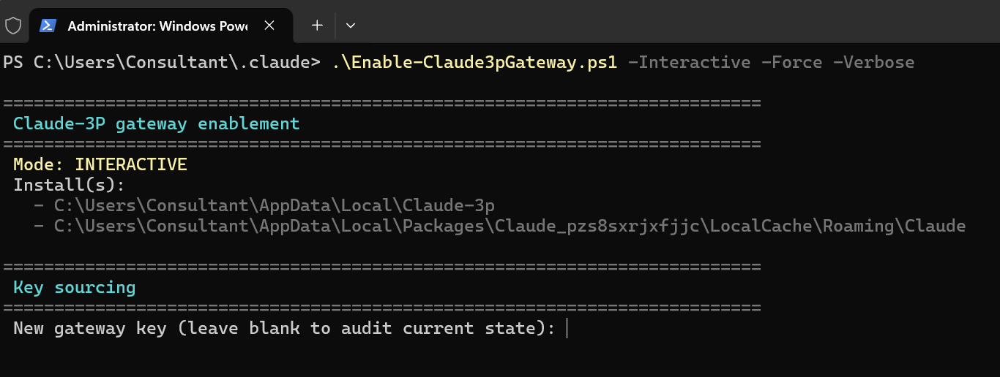

---

## Step-9: Paste your key at the prompt

This step only applies if you omitted `-NewKey` from the command. The script shows a masked prompt and waits. Switch to your notepad window, copy the key, come back here, and paste it after the blinking cursor.

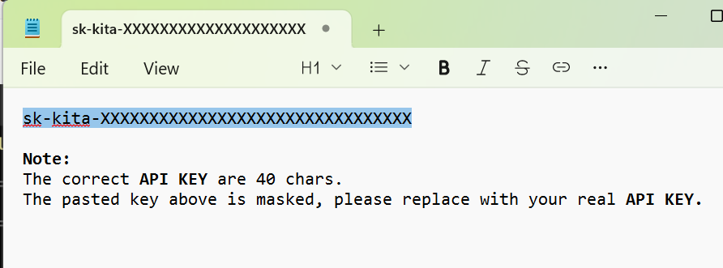

Paste it at the prompt. The typed characters are masked automatically, so it will look like nothing is happening. That is normal. Press Enter when done.

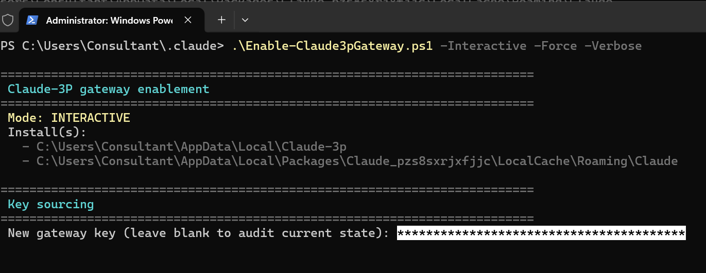

---

## Step-10: Confirm the apply

The script now shows you a plain-English summary: where it will redirect Claude, which files it will overwrite, and whether the URL was verified by the probe. Read it.

If **Claude Desktop** is somehow still running, you also get a warning here with the process IDs. Answer `y` to proceed or `N` to abort and go close Claude first.

Then the final confirm:

```
 Apply these changes? (y/N):
```

Type `y` and press Enter. This is the safety net the script builds in for humans. If you say `N`, nothing is written and you are back to square one, no harm done.


---

## Step-11: Let the script cook

Now the script writes. It sets `deploymentMode` to `3p`, merges the gateway entry into your configLibrary, writes `_meta.json`, syncs the key into `settings.json`, seeds the CLI onboarding flags, and sets your `LLM_KITA_API_KEY` user env var. Every file is backed up to a `.bak` before it is touched.

Here is roughly what the output looks like, minus the HTTP noise:

```
==========================================================================
 Apply
==========================================================================
 -> C:\Users\you\AppData\Local\Claude-3p
   deploymentMode :: set to 3p
   configLibrary :: merged gateway fields  (backup captured)
   _meta.json :: appliedId=00000000-0000-4000-8000-000000000114
 CLI sync (settings.json):
   settings.json env block already current
   settings.json re-parse: VALID

==========================================================================
 Result
==========================================================================
 Changed:
   - configLibrary entry
   - _meta.json

 Post-write probe  /v1/models: 200   /v1/messages: 200 (model=auto)
```

If you see `Post-write probe /v1/models: 200 /v1/messages: 200`, the gateway accepted your key and the writes are live.

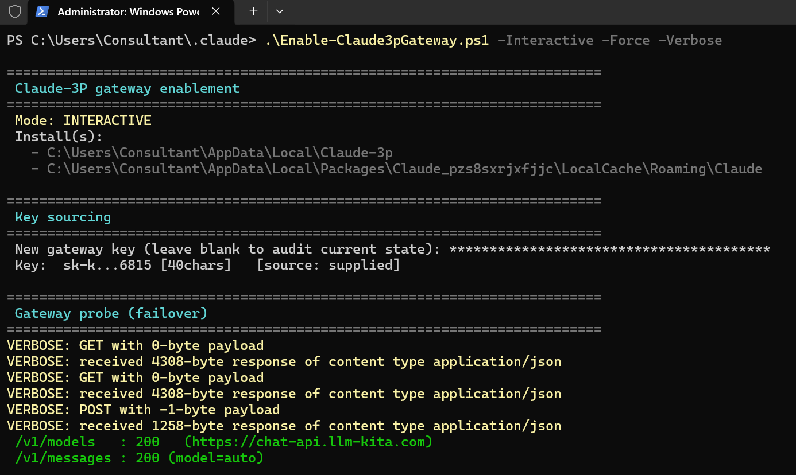

---

## Step-12: Run the verification command

The script prints a final verification command. Run it after you relaunch Claude to confirm the setup window did not reopen and credentials were not rejected:

```powershell
Get-Content "$env:LOCALAPPDATA\Claude-3p\logs\main.log" -Tail 200 | Select-String 'Opening 3P setup window|credential rejected'
```

If the command returns nothing, you are clean. If it returns any matches, something rejected the credentials. Jump to Step-19.


---

## Step-13: Relaunch **Claude Desktop**

Open **Claude Desktop** from the Windows Start menu. It reads the new config at launch, so this is when 3P mode actually takes effect.

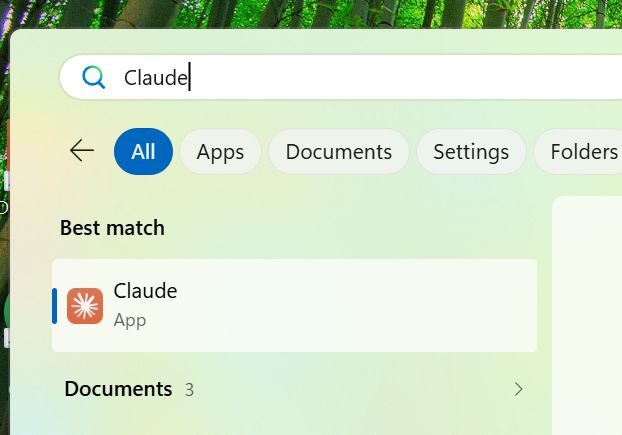

---

## Step-14: Continue at the 3P sign-in

You should now see the 3P Deployment Mode sign-in menu. This is the sign you are not on the default Anthropic endpoint anymore. Click Continue.

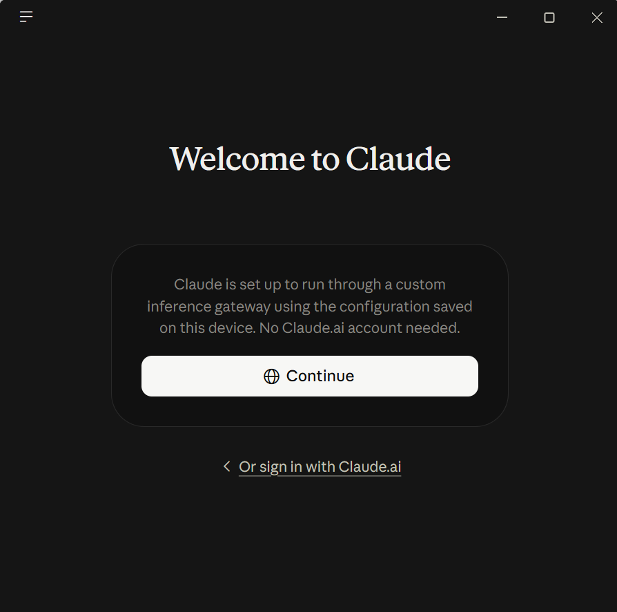

---

## Step-15: Open Inference configuration

Once Claude is signed in, move your cursor to the bottom-left menu item, which is your Windows login user name. Right-click it and select Inference configuration.

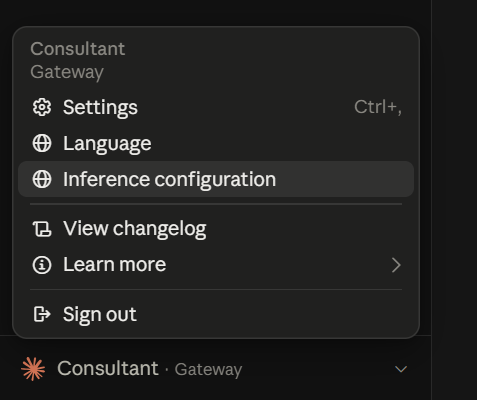

When the configuration screen appears, select Connection in the left panel.

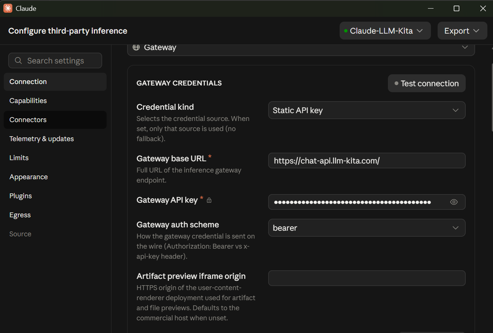

---

## Step-16: Test the connection

Click the Test connection button on the right frame and wait. The status color changes to green when the gateway accepts the connection.

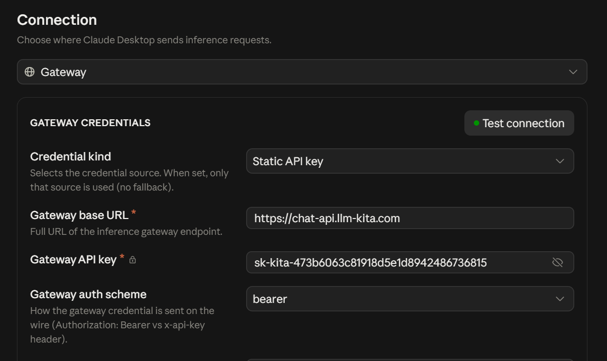

Scroll down a little to find the green-highlighted success message.

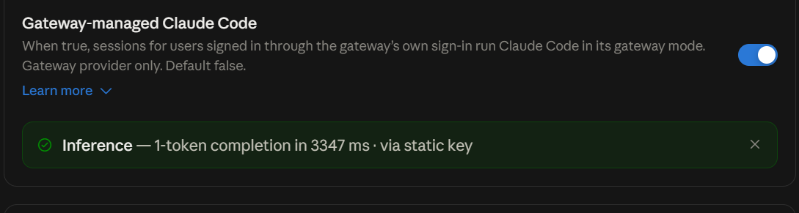

---

## Step-17: Verify model discovery

Keep scrolling. You should see a Model discovery section that lists the available model ids you can use in 3P mode. If the models show up, the gateway catalog is working.

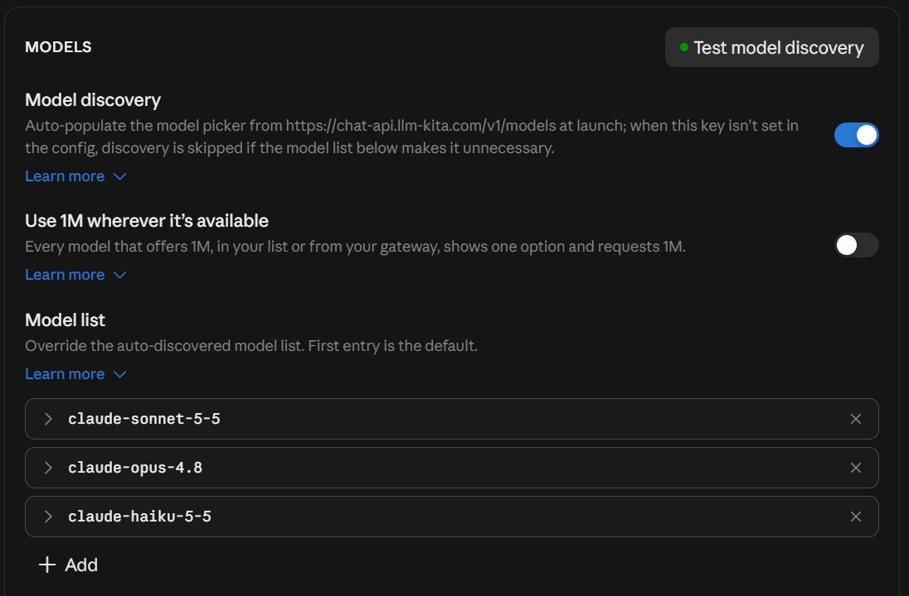

The list should include the Claude models seeded by the script: Sonnet, Opus, and Haiku.

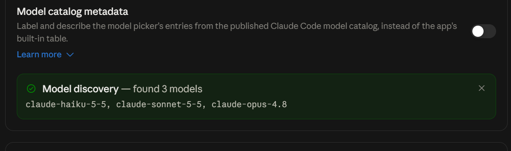

---

## Step-18: Start chatting or coding

That is it. You are running **Claude Desktop** on **LLM-Kita**. Open the Chat or Cowork surface and talk to it.

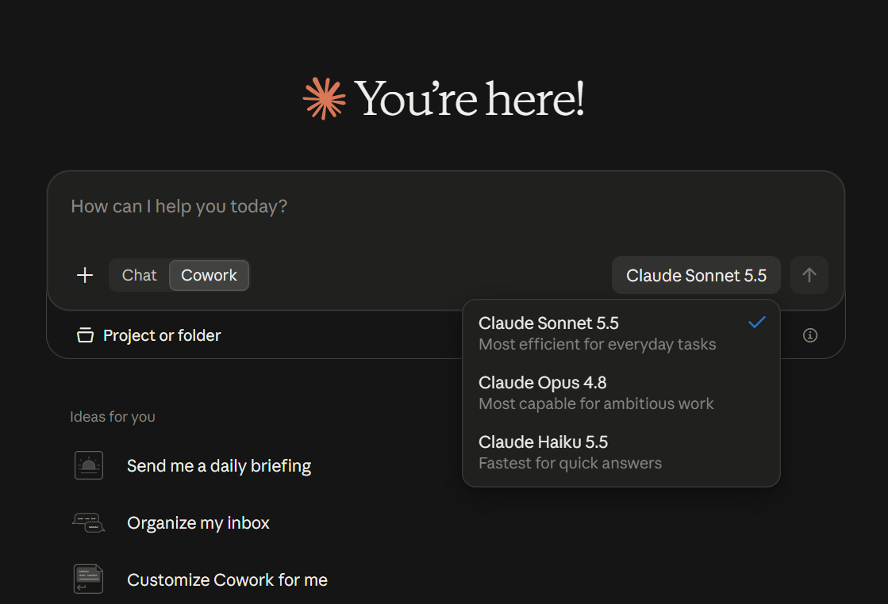

Or jump into the Code surface and keep hacking.

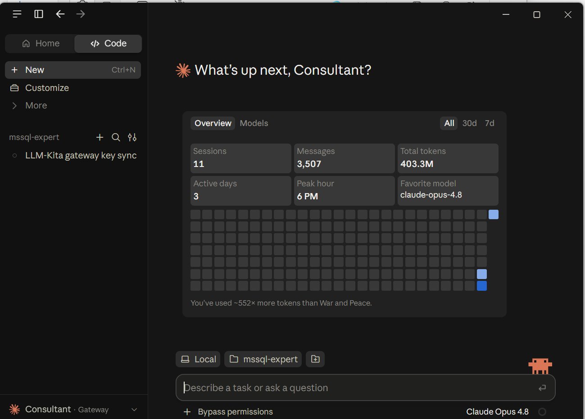

Your wallet will thank you. Welcome to **3P** mode! :laughing:

---

## Step-19: Troubleshooting

Things go sideways sometimes. Here are the common ones and the fix.

| Symptom | Likely cause | Fix |
|---|---|---|
| Exit code 2 | The gateway probe failed for your key | Check the key is valid and funded at **LLM-Kita**, then re-run |
| Exit code 3 | `settings.json` is invalid JSON | Restore from the `.bak` next to it, then re-run |
| Exit code 5 | You said N, or Claude was running without `-Force` | Close Claude, then re-run |
| Claude still hits Anthropic after setup | App is caching old config | Run `.\Enable-Claude3P.ps1 -Apply -ResetCaches -Force`, then relaunch |
| The Code tab does not use the gateway | You ran with `-NoSyncCli` | Re-run without `-NoSyncCli` |
| Git Bash warning at apply time | Git for Windows is not installed | Run `winget install Git.Git`, then re-run |
| `deploymentMode` is blank after setup | The insert step did not run | Re-run `.\Enable-Claude3P.ps1 -Apply -NewKey "<KEY>"` |

Every write produces a `.bak` file next to the original. To recover from a bad state, quit Claude, copy the `.bak` over the live file, and relaunch.

---

## Step-20: Undo everything with Restore

Want out? One command reverts to stock Anthropic mode. It removes `deploymentMode`, deletes the gateway entry, zeros `_meta.json`, strips the gateway fields from `settings.json`, and removes the onboarding bools the script seeded. Your MCP config and anything you set yourself stays put.

```powershell
.\Enable-Claude3P.ps1 -Restore -Apply -Force
```

After Restore, **Claude Desktop** and the CLI are back on the default Anthropic endpoint. No traces of 3P left behind.

---

That is the whole guide. If you hit something this does not cover, run a dry run (`.\Enable-Claude3P.ps1`) and read the report, or check the README.md in the plugin root for the full parameter reference. You are so back.
